

# Uperf Game Turbo

**Brand new performance module for Android supporting 118 CPUs, with 4 customizable profiles for every app.**

## Overview:

 **Uperf Game Turbo** is a **revolutionary Magisk/APatch/KernelSU module** that offers **4 performance profiles that apply in select apps or your entire device**. It can dramatically improve the **speed and responsiveness of your device**, or improve the **battery life** if you decide to use efficient presets.
 
 ## QNA:

 ### Why do I need yet another performance module?
 
- **Good question.** This module is designed to activate performance profiles **only for apps you assign** so you don't have to remove it after one use. Stock performance returns as soon as you leave a boosted app.
 
 
 ### Is my device supported?
 
- **Most likely.** The module uses the original **Uperf-Game-Turbo's 118 CPU configs** (***with a little tweaks from my end***), so there's a high chance that your device is supported.

- **See the full supported CPU list here:** https://pastebin.com/YdXKdBuk
 
 ### Good to know:
 
- The installation script automatically checks if your device is supported. Sometimes, an **incorrect profile may be assigned to your device.** **Check what config was applied before rebooting!**
 
 ### Is it open source?
 
- Yes, **the entire module is open source.** Download the release you want to check and inspect the contents inside. Note that **some files come from the original uperf module,** which **may not be open source!**

---

### **Features:**

- **Performance profiles** that each app can use based on your choice.

- **Apply performance profiles** to the **entire device** or while your screen is off. (***V1.3+ required***)

- **4 performance profiles** ranging from ***Efficient*** to ***Extreme***

- 3 special **Screen Off profiles.**

- **Disable CPU throttling**, **spoof battery temperature**, **increase touch response** in boosted apps and **more** (***V1.1+ required***)

- Toggle to **disable & enable** the module in the UI (***No reboot required***)

- Sliders to change **how often** the module scans for **boosted apps**

- **2 UI styles** to pick from - **Miuix** and **M3E**

- **Gather useful logs** directly from the app that can be used for debugging

- ***and much more :)***

---

### ❗ Magisk dependency

You need to install [WebUI X](https://github.com/MMRLApp/WebUI-X-Portable/releases) (recommended) or [KSU WebUI Standalone](https://github.com/KOWX712/KsuWebUIStandalone/releases) to use this module. This is only required for Magisk.

---

### Screenshots:

<b>Tap to view MIUIx screenshots</b>

 

  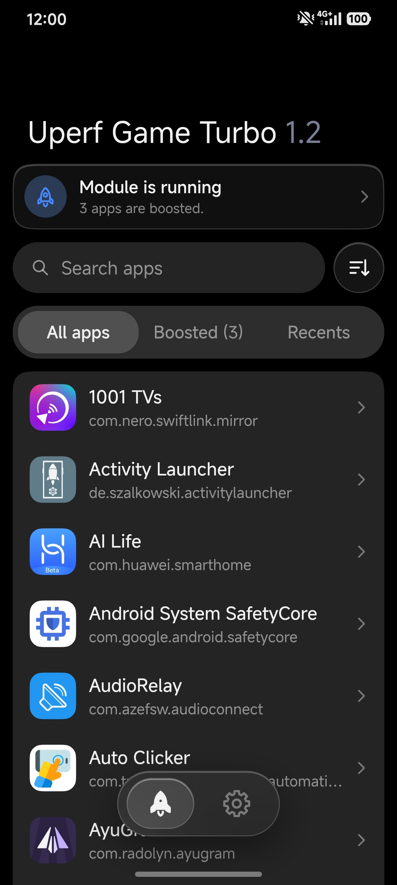 &nbsp;
  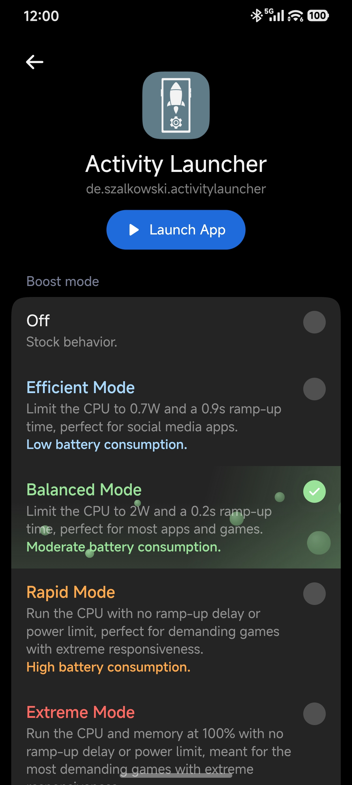
    
  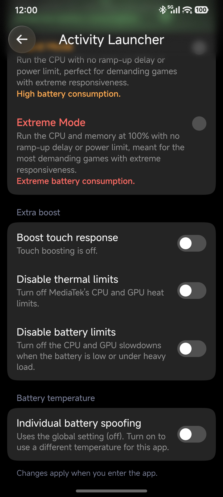 &nbsp;
  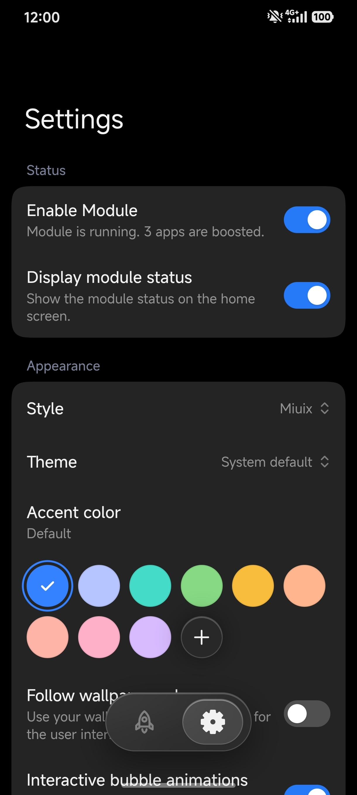
    
  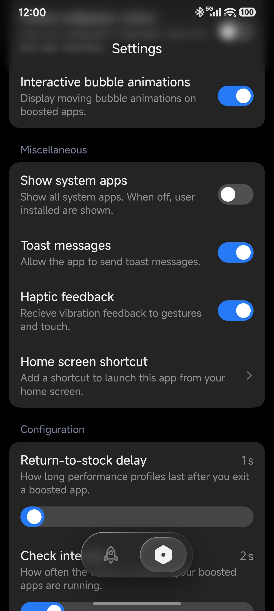 &nbsp;
  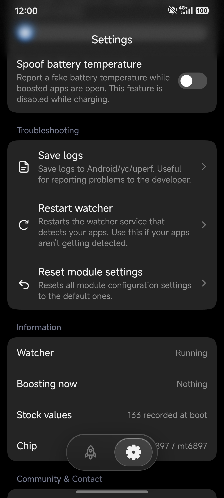

<b>Tap to view M3e screenshots</b>

 

  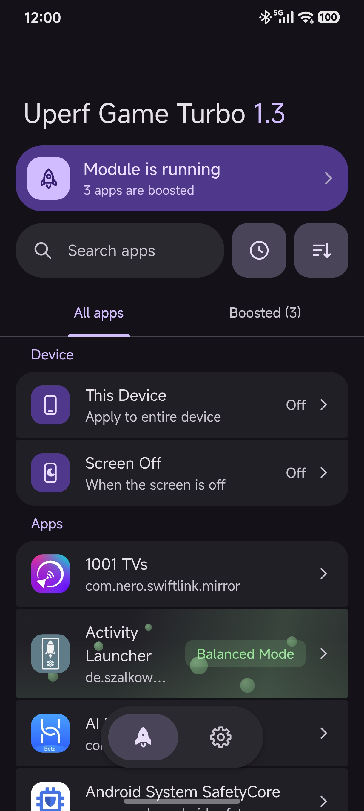 &nbsp;
  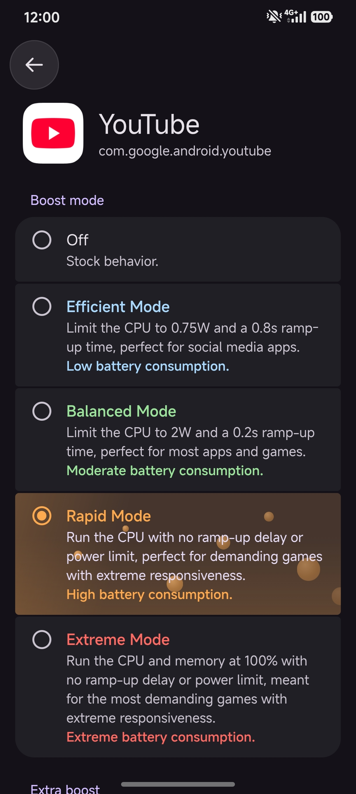
    
  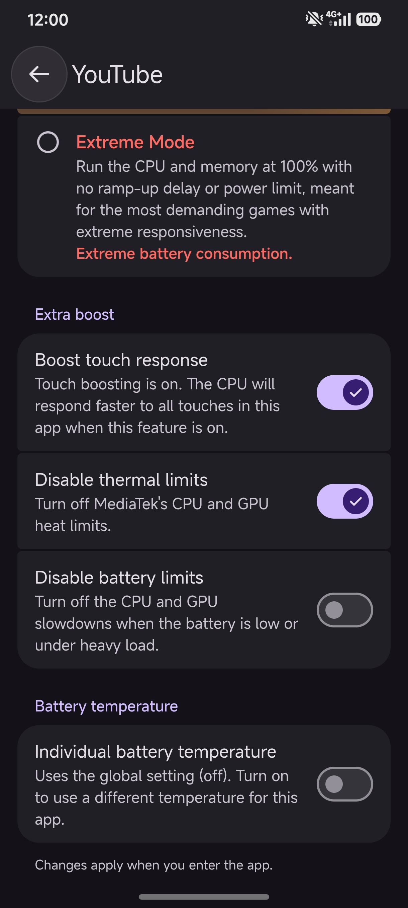 &nbsp;
  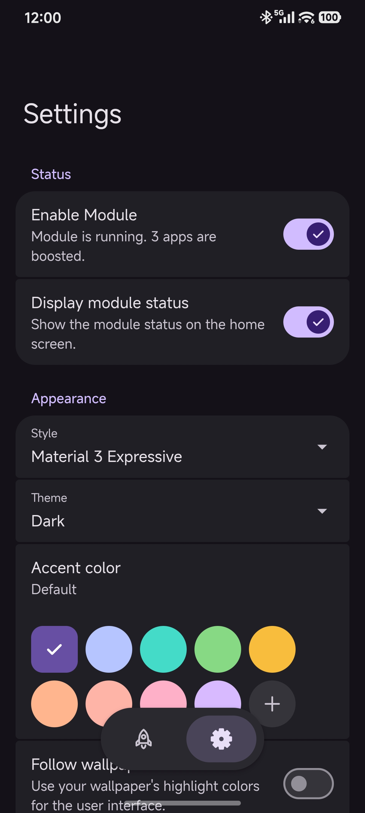
    
  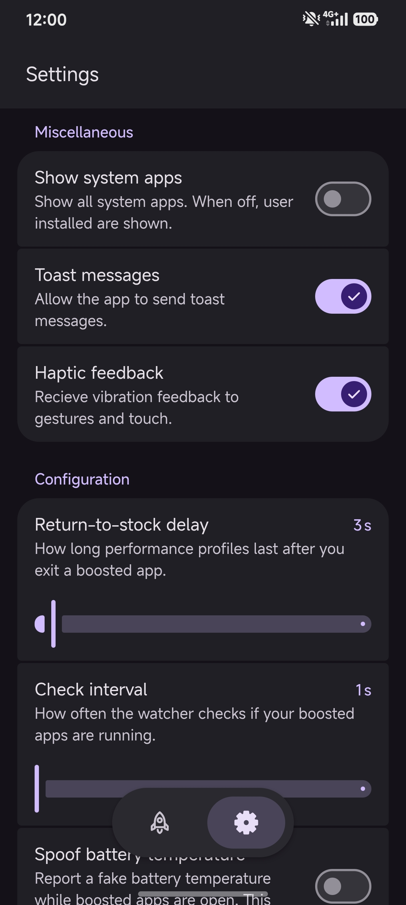 &nbsp;
  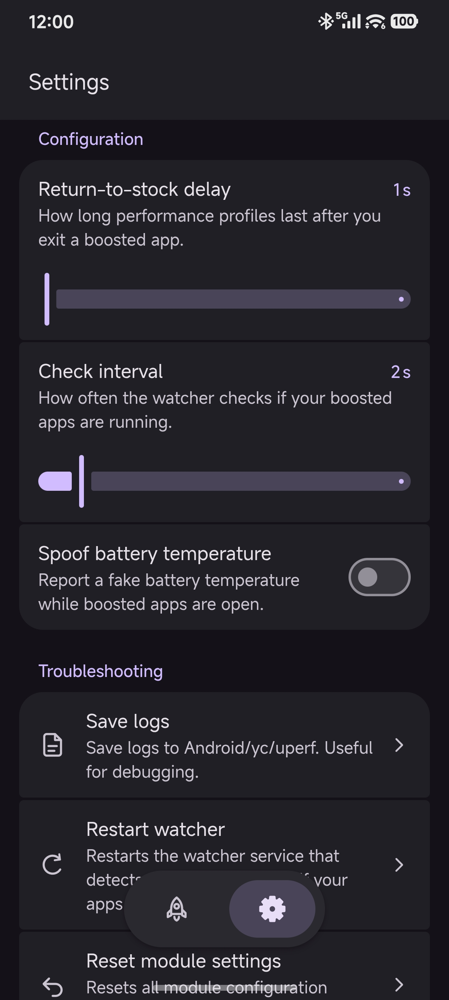

---

### Performance overview

| Profile | Behavior |
| --- | --- |
| Efficient | Power saving profile that limits the CPU to 0.7W and ramp-up speed to 0.9ms. |
| Balanced | Balanced profile that limits the CPU to 2W and ramp-up speed to 0.2ms. |
| Rapid | Rapid profile that doesn't limit the CPU and ramp-up speed. |
| Extreme | Extreme profile that always runs the CPU and memory at 100% with no ramp delay. |

---

### 📩 How to install:

1. Download from the latest release.
2. Open your root manager and flash the module.
3. Reboot.
4. Open the module's settings. On KernelSU and APatch use the WebUI button. On Magisk press Action (WebUI X or KSU WebUI Standalone must be installed).
5. Choose the apps you want to boost.
6. Done!

## ⚖️ Licenses:

Distributed under the same license as the upstream projects. See [LICENSE](LICENSE) and the notices in the Credits section.
