

# Uperf Game Turbo Fork

Revolutionary performance module for Android. Supports over 120+ SOC's.

## 🔎 Overview

🚀 Uperf Game Turbo Fork is a revolutionary Magisk/APatch/KernelSU module that lets you choose between 4 performance profiles for each app. It dramatically improves speed and responsiveness for apps you choose. Unselected apps use the stock performance settings.

📈 This module is designed to be used long-term unlike other performance modules that apply a fast profile to the entire device temporarily. You can enjoy both insane speeds and battery life without needing multiple modules.

---

### 🧩 Features

- 👥 **Per-app profiles.** Pick which apps get a boost and which profile each one uses.

- 🎭 **Four profiles.** You can pick these profiles, you decide which one suits each app best: Efficient, Balanced, Rapid and Extreme.

- 🕑 **Configure return-to-stock delay.** Choose how often the module checks if a boosted app is running and how quickly stock values return on exit.

- 🎨 **Customize the UI.** Change the interface theme, theme colors, animations and much more!

- 🪲 **Logging features.** In case something doesn't work as intended, built-in log gathering will help you understand what went wrong. Send them to me if you want to report a bug.

---

### ‼️ Magisk dependency

You have to install either [WebUI X](https://github.com/MMRLApp/WebUI-X-Portable/releases) (recommended) or [KSU WebUI Standalone](https://github.com/KOWX712/KsuWebUIStandalone/releases) to be able to customize the module. Only required for Magisk, newer root managers natively support a WebUI.

---

### 🖼️ Screenshots

<b>📍 View MIUIx screenshots</b>

 

  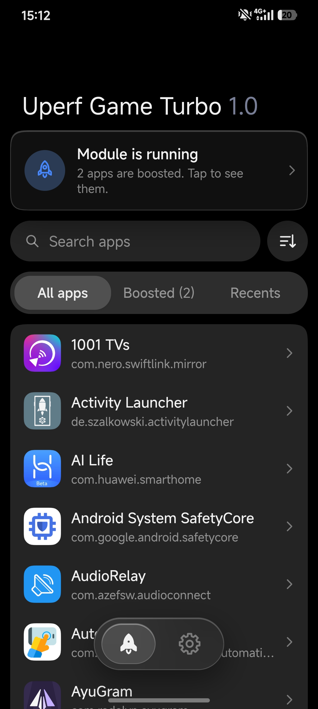 &nbsp;
  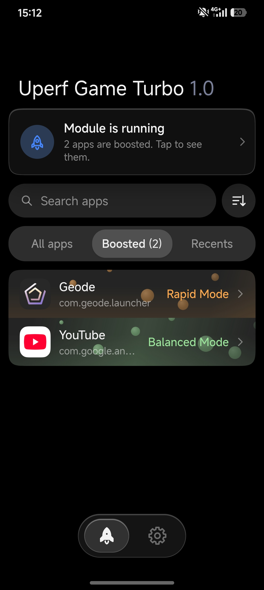
    
  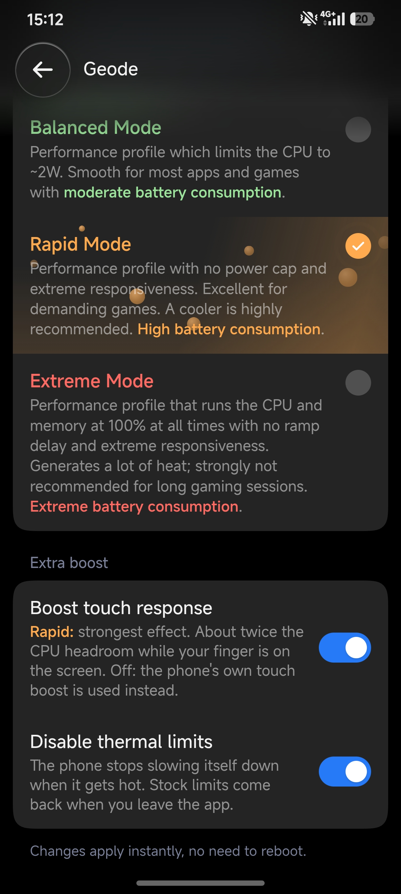 &nbsp;
  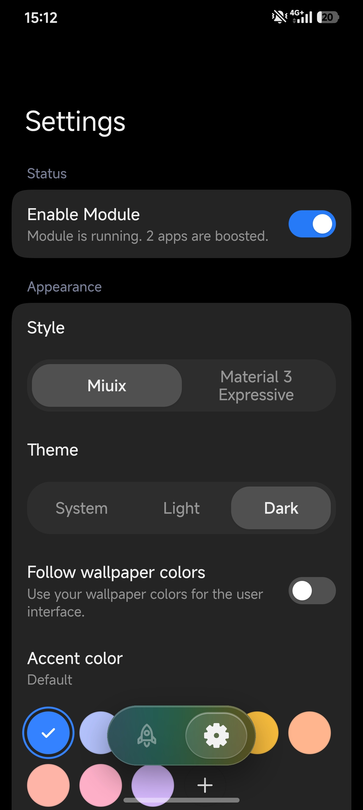
    
  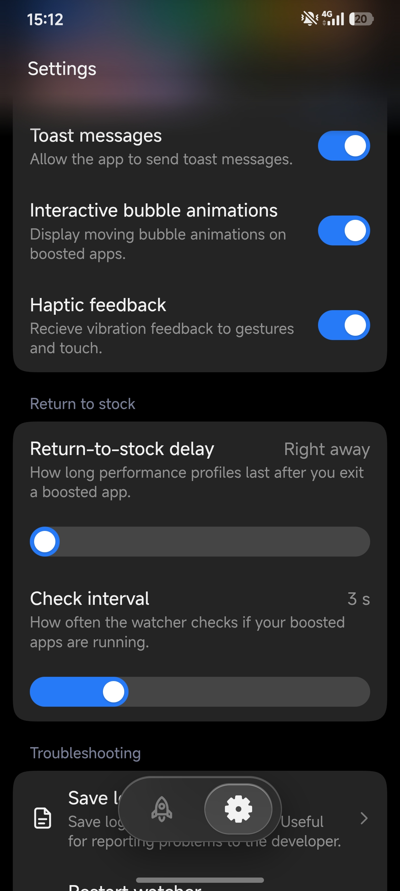 &nbsp;
  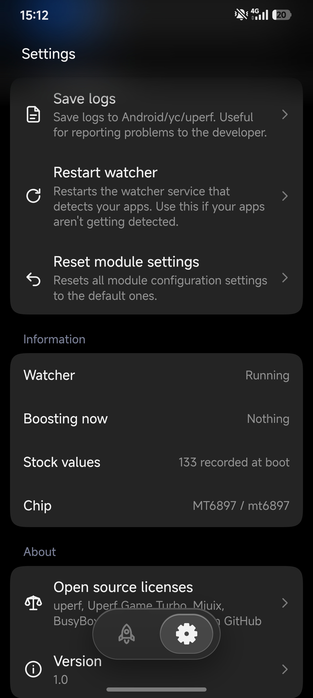

<b>📍 View Material You screenshots</b>

 

  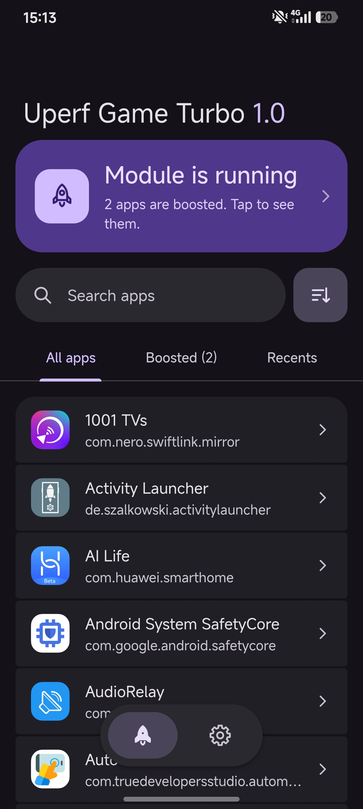 &nbsp;
  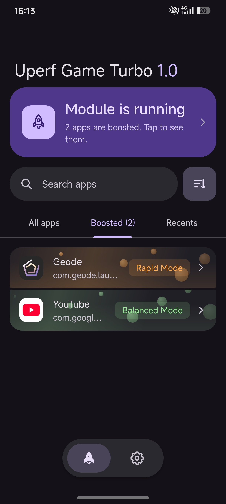
    
  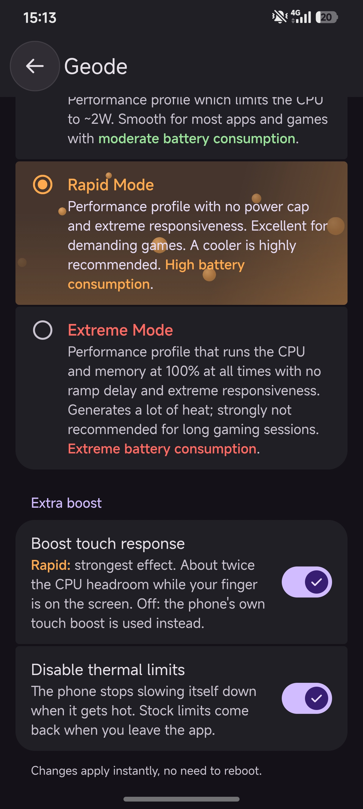 &nbsp;
  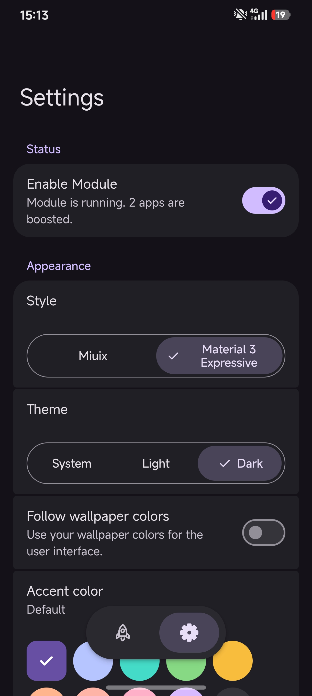
    
  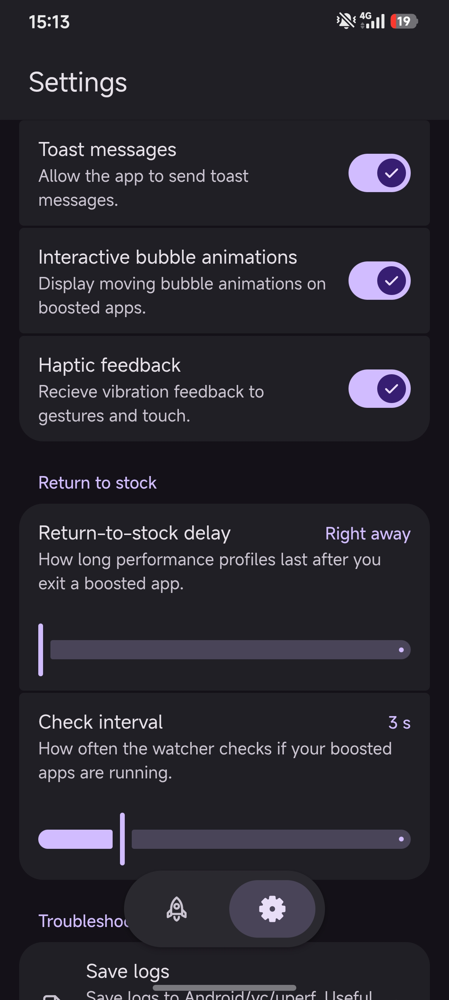 &nbsp;
  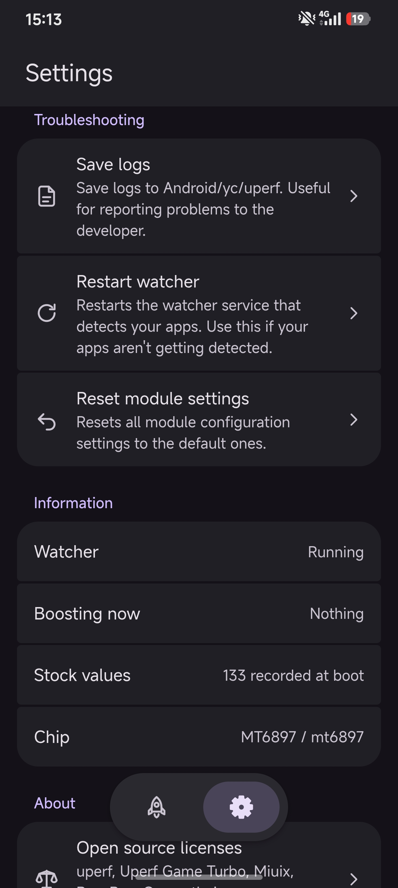

---

### ⚡ Performance profiles

| Profile | Behavior |
| --- | --- |
| Efficient | Power saving profile that limits the CPU to 0.75W. |
| Balanced | Balanced profile that limits the CPU to ~2W. Perfect for everyday usage. |
| Rapid | Rapid profile with no CPU limits. Best for demanding games like Fortnite. High power consumption. |
| Extreme | Extreme profile that runs the CPU and memory at 100% with no ramp delay. Very high battery consumption. |

---

### 📩 Install

1. Download from the latest release.
2. Open your root manager and flash the zip as a module.
3. Reboot.
4. Open the module's settings. On KernelSU and APatch use the WebUI button. On Magisk press Action (WebUI X or KSU WebUI Standalone must be installed).
5. Choose the apps you want to boost.
6. Done!

## ⚖️ Licenses

Distributed under the same license as the upstream projects. See [LICENSE](LICENSE) and the notices in the Credits section.
